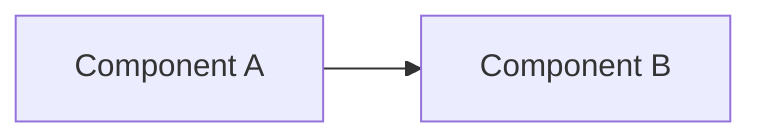

# Title

<!-- Optional badges: build status, license, version -->
<!--  -->
<!--  -->

One-sentence description of what this project does, who it is for, and the problem it solves.

<!-- Optional: a screenshot, and a table of contents for long READMEs -->

## 🚀 Quick Start

Get up and running in under two minutes. Keep this block **self-contained** — clone, install, configure, and run in one place.

```bash
git clone https://github.com/org/repo
cd repo

cp env.example .env    # edit required vars — see ⚙️ Build & Configuration
npm install
npm run start
```

For full prerequisites and env var details, see **📋 Prerequisites & Dependencies** and **⚙️ Build & Configuration** below.

<!-- Optional — delete if not needed -->

### Usage

```bash
npm run dev
npm run lint
```

Day-to-day commands, API examples, or host prompts (e.g. *"Run tool X with …"*).

### Output

Where artifacts land (files, URLs, stdout). Include a short example.

### Configure in your IDE

Cursor, VS Code, Claude, etc. — config file path and minimal JSON snippet.

## ✨ Features

- **Feature 1** — short, punchy description
- **Feature 2** — short, punchy description

<!-- Optional — delete if not needed -->

### Limits

Things the project deliberately does not do, or can't, and why.

## 📋 Prerequisites & Dependencies

List required runtime versions, package managers, global CLI tools, and package sources **before** building.

- Node.js `v20.x` or higher (or Python 3.10+, etc.)
- Package manager or CLI tools (`npm`, `just`, `poetry`, …)
- Docker (optional — for database containerization)
- Accounts or services (GitHub, AWS, …) — link to sign-up or install docs

| Source | Purpose |
| ------ | ------- |
| `package.json` / `requirements.txt` | Runtime and dev packages — installed in **⚙️ Build & Configuration** below |
| Sibling project / service | e.g. database container, MCP server — link to its README |

<!-- Optional — delete if not needed -->

### Supported platforms

Which IDEs, OS versions, or runtimes it runs on (and which it doesn't), and what file you install on each.

| Platform | Minimum version | File / package |
| -------- | --------------- | -------------- |
| Platform A | 1.0 | `app.zip` |

## ⚙️ Build & Configuration

Build steps and environment configuration. **Never commit real keys** — use `env.example` with placeholders only.

### Build

```bash
cd project
cp env.example .env
just build    # or: npm install, pip install -r requirements.txt, docker compose up -d
```

Where the build output lands (installable files, `dist/`, …).

### Environment variables

| Variable | Required | Description | Default / example |
| -------- | -------- | ----------- | ----------------- |
| `DATABASE_URL` | Yes | Connection string for the primary database | `postgresql://...` |
| `PORT` | No | Local port to run the server on | `8080` |

Use a bullet list instead when you only have a few variables.

<!-- Optional — delete if not needed -->

### Settings

Every user-facing setting, config key, CLI option, Gradle/Make property or flag. One table per kind (for example *Settings*, *CLI options*, *Gradle properties*, *Make variables*).

| Setting | What it does |
| ------- | ------------ |
| `app.someSetting` | Effect, default value, and any caution |

### Versioning

How the release version is chosen and where it's stamped (for example `version.sh` over the commit count, the `VERSION=` override, and which file holds the fallback). Say how a release is tagged and what a shallow clone breaks.

### Authentication

How to log in or create tokens (`just login`, OAuth device flow, PAT scopes).

### Security

Token scopes, rotation, `.env` rules, and host-specific secret input. **Never commit** `.env` or credentials.

### Deploy

Production, Docker image, marketplace publishing, or `just deploy` / CI steps beyond local build. Link to `DEPLOY.md` when there is one.

### Just commands

| Command | Description |
| ------- | ----------- |
| `just build` | Install dependencies |
| `just test` | Run tests |

<!-- Optional — delete if not needed -->

## 📦 Installation

For products people install rather than clone: one subsection per platform, each with **Install**, **Check that it works**, **Update** and **Uninstall**.

### Install on Platform A

1. Step one.
2. Step two.

**Check that it's installed:** what the user should see.

**Update:** …  **Uninstall:** …

<!-- Optional — delete if not needed -->

## 📖 Usage Guide

For products with a user interface: a walk-through of everyday use, in the order a user meets it (open, connect, configure, use, review). Number the subsections (`### 1. …`) so the README can link to them.

### Commands

| Command | Does |
| ------- | ---- |
| `/example` | What it does |

## 📁 Project Layout

```
Project/
├── app/                        # Application package (same base as iws/app)
│   ├── db/                     # Database wiring
│   │   ├── base.py             # Declarative base (AbstractModel)
│   ├── models/                 # SQLAlchemy models
│   │   ├── base.py             # BaseModel (UUID primary key)
│   ├── repositories/           # Persistence layer
│   │   └── base.py             # BaseRepository, InMemory, SqlAlchemy
│   ├── exceptions/             # Error types and handlers
│   │   ├── base.py             # Shared error base
│   │   ├── client.py           # 4xx errors
│   │   ├── server.py           # 5xx errors
│   │   └── handlers.py         # FastAPI exception handlers
│   ├── enums/                  # Enumerations
│   │   └── base.py             # Base enum helpers
│   ├── utils/                  # Helpers
│   │   └── base.py             # Shared utilities
│   ├── routes/                 # Empty — API routers go here
│   ├── schemas/                # Empty — pydantic request/response models
│   ├── services/               # Empty — business logic
│   ├── webhooks/               # Empty — inbound webhook handlers
│   ├── config.py               # Settings loaded from .env
│   └── main.py                 # FastAPI app + include_router(webapp)
├── webapp/                     # Web UI mounted in the API process
│   ├── static/                 # Static assets
│   │   ├── css/                # Empty — stylesheets
│   │   ├── js/                 # Empty — scripts
│   │   └── images/             # Empty — images
│   ├── routes/                 # Empty — UI routers go here
│   ├── templates/              # Empty — Jinja templates
│   └── main.py                 # APIRouter with the UI routes
├── tests/                      # Test suite
│   ├── conftest.py             # Env + schema bootstrap fixture
│   └── test_health.py          # /health endpoint test
├── docs/                       # Layout documentation
│   └── Architecture.md         # Architecture notes skeleton
├── data/                       # Empty — local data files (keep out of git)
├── infra/                      # Empty — Docker, k8s, CI manifests
├── Makefile                    # setup, install, start, test, status
├── requirements.txt            # Python dependencies
└── README.md                   ← you are here
```

Optional table mapping paths or modules to their purpose. For a monorepo or suite, list each sub-project and link to its README.

## 🏗️ Architecture

Describe how components connect. Prefer a **Mermaid** diagram for flows; use a table for roles or dependencies.



<!-- Optional — delete if not needed -->

### Components

| ID | Component | File |
| -- | --------- | ---- |
| C1 | What it does | `src/file.ts` |

### Data flow

Step-by-step path (e.g. client → API → database → export file).

### MCP connections

Host embedded client vs standalone CLI → server (if applicable).

### Changing the contract

How to change a shared interface safely: which file to edit, what to regenerate, which implementations and tests to update.

## 🧪 Testing

```bash
npm test              # or: just test, pytest
npm run test:coverage # optional
```

Describe manual or integration checks if automated tests are not enough.

<!-- Optional — delete if not needed -->

### Test without installing

How to run the project from source in a throwaway window, sandbox, or browser.

### Manual test script

1. Start the project.
2. Do this. You should see that.

## 🛠️ Troubleshooting

Address two or three common newcomer issues.

**Port already in use**

- **Cause:** another process on the default port
- **Fix:** change `PORT` in `.env` or stop the conflicting service

| Issue | Fix |
| ----- | --- |
| Short description | One-line fix or link to a subsection above |

<!-- Optional — delete if not needed -->

### Logs

Where the logs are, how to turn on more detail, and what a normal start looks like.

### Known issues

Problems caused by a third party (an IDE release, a service), with the symptom, the workaround, and when to remove the entry.

### Security

Leaked secrets, committed `.env`, wrong token scope, or revoked keys.

<!-- Optional — delete if not needed -->

## 🔒 Privacy & Security

What data the project reads, sends, and stores, and where. Link to `PRIVACY.md` and `SECURITY.md`.

## 📚 References

### In this repository

For a single project or module, link to its parent and to related READMEs:

| README / Link | Description |
| ------------- | ----------- |
| [Parent](../README.md) | Parent index or related project |

**Index / suite READMEs** (a README that sits above sub-modules) use one combined table instead, and link **only** to the sub-modules' `README.md` files. Don't link `DEPLOY.md`, `PRIVACY.md`, `docs/`, `LICENSE` or anchors from here; name those files in plain text where needed. Sort the rows alphabetically by module path, and give each row a one-line description:

| Module | Link | Description |
| ------ | ---- | ----------- |
| `module-a` | [module-a/README.md](module-a/README.md) | What module A is |
| `module-a/sub` | [module-a/sub/README.md](module-a/sub/README.md) | What the sub-module is |
| `module-b` | [module-b/README.md](module-b/README.md) | What module B is |

### External Documentation

| Link | Description |
| ---- | ----------- |
| [Official docs](https://example.com) | API reference, design specs, etc. |

<!-- Optional — delete if not needed -->

### Documentation and support

Source and docs, where to report a problem (and what to include), privacy and security links. Needed in READMEs that a marketplace shows.

## 📄 License

Distributed under the [MIT License](LICENSE) (or name your license). For index/catalog READMEs, don't link the license files: name the `LICENSE` file of each child project in plain text instead.

## 👤 Author

- **Rohtash Lakra** — [@rslakra](https://github.com/rslakra)


---

> **Note:** Skip or shorten whole sections that do not apply. Keep the order shown here. Optional subsections are listed below — delete any you do not need. Add **🤝 Contributing** only if you accept external contributions (or link to `CONTRIBUTING.md`). When you shorten or move a section, keep every fact in it: move the text, don't drop it.

### Optional subsections (reference)

| Subsection | Add under | When to use |
| ---------- | --------- | ----------- |
| `### Usage` | 🚀 Quick Start | Day-to-day commands, API, or tool calls after first run |
| `### Output` | 🚀 Quick Start | Where files go, response format, sample result |
| `### Configure in your IDE` | 🚀 Quick Start | MCP, LSP, or editor-specific setup |
| `### Limits` | ✨ Features | What it can't or won't do |
| `### Supported platforms` | 📋 Prerequisites & Dependencies | Several IDEs or OSes, each with its own file |
| `### Settings` | ⚙️ Build & Configuration | User-facing settings, CLI options, Gradle/Make properties |
| `### Versioning` | ⚙️ Build & Configuration | The version is computed (for example from the commit count), not edited by hand |
| `### Authentication` | ⚙️ Build & Configuration | OAuth, login, API keys, token storage |
| `### Security` | ⚙️ Build & Configuration or 🛠️ Troubleshooting | Scopes, secrets, never-commit rules |
| `### Deploy` | ⚙️ Build & Configuration | Production, Docker, marketplace, CI/CD publish steps |
| `### Just commands` | ⚙️ Build & Configuration | Command runner (Just, Make) cheat sheet |
| `## 📦 Installation` | after ⚙️ Build & Configuration | Installable products: install, check, update, uninstall per platform |
| `## 📖 Usage Guide` | after 📦 Installation | Products with a UI: everyday use, step by step |
| `### Commands` | 📖 Usage Guide | Slash commands, command-palette entries, CLI commands |
| `### Components` | 🏗️ Architecture | Numbered components and the file each lives in |
| `### Data flow` | 🏗️ Architecture | Request/path through the system |
| `### MCP connections` | 🏗️ Architecture | Host → client → server diagrams |
| `### Changing the contract` | 🏗️ Architecture | Shared interfaces that several implementations follow |
| `### Test without installing` | 🧪 Testing | Dev windows, sandboxes, browser dev hosts |
| `### Manual test script` | 🧪 Testing | Checks a headless test can't do |
| `### Logs` | 🛠️ Troubleshooting | Log locations and what a normal start looks like |
| `### Known issues` | 🛠️ Troubleshooting | Third-party breakage with a workaround |
| `## 🔒 Privacy & Security` | before 📚 References | Anything that reads, sends or stores user data |
| `### Documentation and support` | 📚 References | Marketplace-facing READMEs |
| Module / Link / Description table | 📚 References → In this repository | Index or suite READMEs: sub-module READMEs only, sorted alphabetically |

### Section order

🚀 Quick Start → ✨ Features → 📋 Prerequisites & Dependencies → ⚙️ Build & Configuration → 📦 Installation → 📖 Usage Guide → 📁 Project Layout → 🏗️ Architecture → 🧪 Testing → 🛠️ Troubleshooting → 🔒 Privacy & Security → 📚 References → 📄 License → 👤 Author
