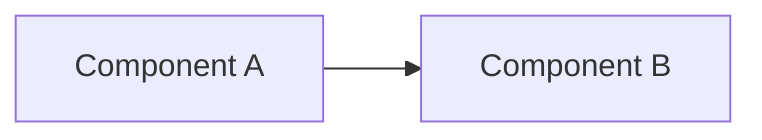

# Title

<!-- Optional badges: build status, license, version -->
<!--  -->
<!--  -->

One-sentence description of what this project does, who it is for, and the problem it solves.

## 🚀 Quick Start

Get up and running in under two minutes. Keep this block **self-contained** — clone, install, configure, and run in one place.

```bash
git clone https://github.com/org/repo
cd repo

cp env.example .env    # edit required vars — see ⚙️ Build & Configuration
npm install
npm run start
```

For full prerequisites and env var details, see **📋 Prerequisites & Dependencies** and **⚙️ Build & Configuration** below.

<!-- Optional — delete if not needed -->

### Usage

```bash
npm run dev
npm run lint
```

Day-to-day commands, API examples, or host prompts (e.g. *"Run tool X with …"*).

### Output

Where artifacts land (files, URLs, stdout). Include a short example.

### Configure in your IDE

Cursor, VS Code, Claude, etc. — config file path and minimal JSON snippet.

## ✨ Features

- **Feature 1** — short, punchy description
- **Feature 2** — short, punchy description

## 📋 Prerequisites & Dependencies

List required runtime versions, package managers, global CLI tools, and package sources **before** building.

- Node.js `v20.x` or higher (or Python 3.10+, etc.)
- Package manager or CLI tools (`npm`, `just`, `poetry`, …)
- Docker (optional — for database containerization)
- Accounts or services (GitHub, AWS, …) — link to sign-up or install docs

| Source | Purpose |
| ------ | ------- |
| `package.json` / `requirements.txt` | Runtime and dev packages — installed in **⚙️ Build & Configuration** below |
| Sibling project / service | e.g. database container, MCP server — link to its README |

## ⚙️ Build & Configuration

Build steps and environment configuration. **Never commit real keys** — use `env.example` with placeholders only.

### Build

```bash
cd project
cp env.example .env
just build    # or: npm install, pip install -r requirements.txt, docker compose up -d
```

### Environment variables

| Variable | Required | Description | Default / example |
| -------- | -------- | ----------- | ----------------- |
| `DATABASE_URL` | Yes | Connection string for the primary database | `postgresql://...` |
| `PORT` | No | Local port to run the server on | `8080` |

Use a bullet list instead when you only have a few variables.

<!-- Optional — delete if not needed -->

### Authentication

How to log in or create tokens (`just login`, OAuth device flow, PAT scopes).

### Security

Token scopes, rotation, `.env` rules, and host-specific secret input. **Never commit** `.env` or credentials.

### Deploy

Production, Docker image, or `just deploy` / CI steps beyond local build.

### Just commands

| Command | Description |
| ------- | ----------- |
| `just build` | Install dependencies |
| `just test` | Run tests |

## 📁 Project Layout

```
project/
├── src/
│   └── main.js         # Entry point
├── tests/
├── env.example
└── README.md           ← you are here
```

Optional table mapping paths or modules to their purpose.

## 🏗️ Architecture

Describe how components connect. Prefer a **Mermaid** diagram for flows; use a table for roles or dependencies.



<!-- Optional — delete if not needed -->

### Data flow

Step-by-step path (e.g. client → API → database → export file).

### MCP connections

Host embedded client vs standalone CLI → server (if applicable).

## 🧪 Testing

```bash
npm test              # or: just test, pytest
npm run test:coverage # optional
```

Describe manual or integration checks if automated tests are not enough.

## 🛠️ Troubleshooting

Address two or three common newcomer issues.

**Port already in use**

- **Cause:** another process on the default port
- **Fix:** change `PORT` in `.env` or stop the conflicting service

| Issue | Fix |
| ----- | --- |
| Short description | One-line fix or link to a subsection above |

<!-- Optional — delete if not needed -->

### Security

Leaked secrets, committed `.env`, wrong token scope, or revoked keys.

## 📚 References

### In this repository

| README / Link | Description |
| ------------- | ----------- |
| [Parent](../README.md) | Parent index or related project |

### External Documentation

| Link | Description |
| ---- | ----------- |
| [Official docs](https://example.com) | API reference, design specs, etc. |

## 📄 License

Distributed under the [MIT License](LICENSE) (or name your license). For index/catalog READMEs, link to the child project license instead.

## 👤 Author

- **Rohtash Lakra** — [@rslakra](https://github.com/rslakra)


---

> **Note:** Skip or shorten whole sections that do not apply. Optional subsections are listed below — delete any you do not need. Add **🤝 Contributing** only if you accept external contributions (or link to `CONTRIBUTING.md`).

### Optional subsections (reference)

| Subsection | Add under | When to use |
| ---------- | --------- | ----------- |
| `### Usage` | 🚀 Quick Start | Day-to-day commands, API, or tool calls after first run |
| `### Output` | 🚀 Quick Start | Where files go, response format, sample result |
| `### Configure in your IDE` | 🚀 Quick Start | MCP, LSP, or editor-specific setup |
| `### Authentication` | ⚙️ Build & Configuration | OAuth, login, API keys, token storage |
| `### Security` | ⚙️ Build & Configuration or 🛠️ Troubleshooting | Scopes, secrets, never-commit rules |
| `### Deploy` | ⚙️ Build & Configuration | Production, Docker, CI/CD publish steps |
| `### Just commands` | ⚙️ Build & Configuration | Command runner cheat sheet |
| `### Data flow` | 🏗️ Architecture | Request/path through the system |
| `### MCP connections` | 🏗️ Architecture | Host → client → server diagrams |
